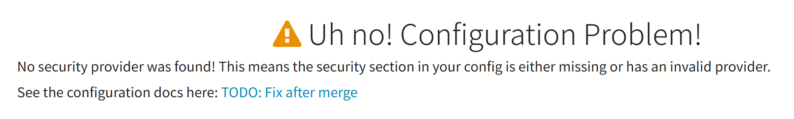
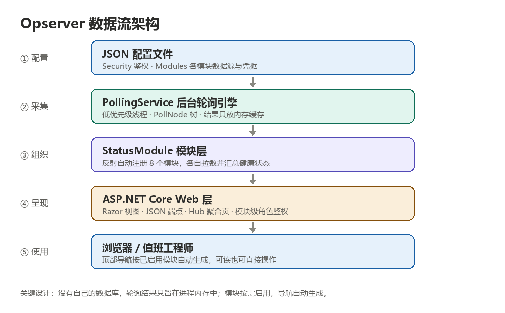
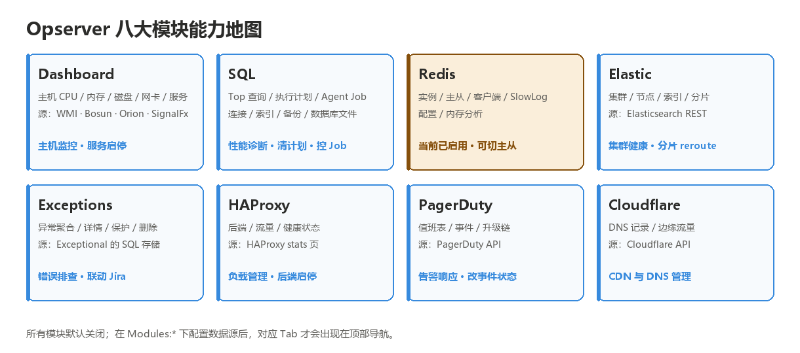
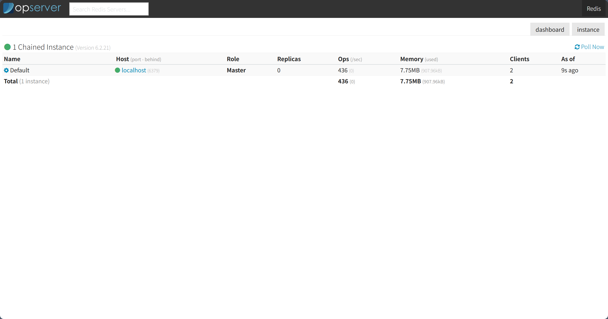

# Opserver 深度解析：Stack Overflow 开源的「一屏看全栈」运维面板

> 从一个黄色的报错页说起，聊清楚这个项目的出身、架构、八大模块，以及把它升级到 .NET 10 之后踩过的坑。本文基于 Opserver 实际代码与一次完整的本地运行验证写成。

## 一、从一张「Configuration Problem」说起

第一次把 Opserver 跑起来，浏览器里大概率是这个页面：



很多人第一反应是「装坏了」。其实恰恰相反——这是 Opserver **刻意设计的安全默认值**：`opserverSettings.json` 里没有 `Security` 配置节，`SecurityManager.GetProvider()` 就会落到 `UnconfiguredProvider`（`IsConfigured = false`），`AuthController.Login` 直接渲染 `Views/Shared/NoConfiguration.cshtml`；同时 `HomeController` 带着 `[OnlyAllow(Roles.Authenticated)]`，访问根路径一律 302 跳到 `/login`。

换句话说：**没配鉴权、没配监控对象，它就拒绝给任何人看任何东西**。代码注释写得很直白——"If people want read-all access...it should be explicit. Default is no access."。页面里那句 `See the configuration docs here: TODO: Fix after merge` 是上游模板留下的占位死链，跟配置错误无关。

## 二、它到底是什么

Opserver 是 Stack Exchange（Stack Overflow 母公司）开源的监控系统，MIT 许可，仓库 `StackExchange/Opserver`。官方 readme 只有一句话定位：*"Opserver is a monitoring system originally from the team at Stack Exchange, home of Stack Overflow."*

更准确的说法是：**统一运维监控 + 轻量处置面板**。它把 SQL Server、Redis、Elasticsearch、主机、HAProxy、异常日志、PagerDuty 值班、Cloudflare DNS 这些系统的当前健康状态，聚到一套 ASP.NET Core Web UI 里；而且不只是"看"，还能直接在页面上切主从、启停 SQL Agent Job、清执行计划。

它不是 Prometheus / Grafana 那种长期时序监控：没有时序数据库、不存历史曲线、不让你写查询语句。它更像叠在现有组件上方的一块**实时控制台**——值班时打开一屏，判断现状，顺手处理。

## 三、整体架构：五层，一次轮询



从配置到浏览器，数据链路是单向的五层：

1. **配置层**：`Program.cs` 按顺序加载 `appSettings.json`、一批 `Config/*Settings.json` 兼容文件、`opserverSettings.json`、以及最后加载的 `localSettings.json`（后者被 `.gitignore` 忽略，专门给本地覆盖用）。
2. **采集层**：`PollingService` 是一个 `IHostedService`，起一条低优先级后台线程，按 `PollNode` 树周期性拉取各系统状态，结果写入 `IMemoryCache`。
3. **组织层**：`StatusModule` 子类各自负责一类系统。`StatusModule.cs` 里 `AddStatusModules()` 用反射扫描程序集，把所有非抽象子类注册成单例——加新模块不需要改注册代码。
4. **呈现层**：Razor 视图 + 大量 JSON 端点 + `/hub` 聚合页，配合模块级角色鉴权。
5. **使用层**：`NavTab.ConfigureAll()` 通过反射找控制器上的 `[DefaultRoute]`，**只为已启用的模块生成顶部 Tab**。

三个值得记住的设计取舍：

- **没有自己的数据库**。轮询结果只留在进程内存里，重启即重新拉取。所以部署极轻，但也就没有历史趋势可查。
- **一切由配置驱动**。`Modules:*` 下配了数据源，模块才算 `Enabled`；仓库自带的 `opserverSettings.json` 把各模块示例全注释了，默认一个都不开。
- **权限颗粒度到模块**。`EveryonesReadOnly` 和 `EveryonesAnAdmin` 是两种极端 Provider，生产可用 `ActiveDirectory` 或 `OIDC`；再叠加每个模块的 `ViewGroups` / `AdminGroups`，把「能看」和「能动手」分开。

## 四、八大模块：它到底能看什么



| 模块 | 路由 | 主要看什么 | 数据来源 |
| --- | --- | --- | --- |
| Dashboard | `/dashboard` | 主机 CPU / 内存 / 磁盘 / 网卡 / 卷 / 服务状态与曲线 | WMI、Bosun、Orion、SignalFx |
| SQL | `/sql` | Top 查询、执行计划、活跃会话、连接、Agent Job、内存、错误日志、库表索引、备份还原、AlwaysOn 可用组 | SQL Server DMV / 系统视图 |
| Redis | `/redis` | 实例、主从、副本、客户端、SlowLog、配置、内存 Key 分析 | Redis `INFO` / `CONFIG` |
| Elastic | `/elastic` | 集群、节点、索引、分片健康、集群设置 | Elasticsearch REST |
| Exceptions | `/exceptions` | 异常聚合、详情、堆栈、筛选、保护与删除、Jira 联动 | StackExchange.Exceptional 的 SQL 存储 |
| HAProxy | `/haproxy` | 后端、流量、健康状态、分组 | HAProxy stats 页 |
| PagerDuty | `/pagerduty` | 值班表、事件、升级链 | PagerDuty API |
| Cloudflare | `/cloudflare` | DNS 记录、边缘流量 | Cloudflare API |

其中 **SQL 和 Redis 是功能最深的两个**。`Views/SQL` 目录下有二十多个视图，从 `Operations.Top`（按 CPU / 读写的 Top 查询）、`Instance.Memory`、`Connections`，到 `Databases.Modal.MissingIndexes`、`UnusedIndexes`、`Backups`、`Restores`，基本把 DBA 日常排障要看的 DMV 都做成了页面。`Views/Redis` 则覆盖 `Clients`、`Config`、`Info`、`SlowLog`、`Analysis.Memory`，并能导出实例配置 zip。

`/hub`（别名 `/headsup`）是另一个有意思的入口：它把各模块的当前问题和告警汇总到一页，是真正意义上的「值班首页」。配套的还有 `/issues`（问题聚合）、`/about`（认证信息与模块状态）、`/about/caches`（缓存）、`/ping`（健康检查）、`/debug`（请求头与轮询线程状态）、`/poll`（轮询控制）以及 `api/node/enable|disable`（维护摘挂）。项目还内置了 MiniProfiler，可以在 `/mini-profiler-resources/results-index` 查看每次请求的耗时明细。

## 五、真正的特色：能动手，不只是能看

绝大多数监控面板是只读的，Opserver 不是。每个模块都有一份 `*.Admin.cs`，端点带 `[OnlyAllow(...Roles.Admin)]`：

- Redis（`RedisController.Admin.cs`）：kill 客户端、提升主库、切换复制源、清理 Key、设置 / 清除 tiebreaker、批量执行服务端动作；
- SQL（`SQLController.Admin.cs`）：移除执行计划、启停 / 开关 Agent Job；
- 其他：HAProxy 后端启停、Dashboard 服务启停、PagerDuty 改事件状态与值班覆盖、Cloudflare DNS 变更、Exceptions 删除 / 保护异常并关联 Jira。

这些动作统一受 `SecurityManager` + `Roles`（`Anonymous` / `Authenticated` / `LocalRequest` / `InternalRequest` / `ApiRequest` / `GlobalAdmin` / `GlobalViewer`）+ 模块级 `ViewGroups` / `AdminGroups` 约束。也正因如此，**默认不给任何访问权限**才显得合理：一旦放开，页面上的按钮是真的会改生产状态的。

## 六、横向对比：Opserver vs Prometheus + Grafana

| 维度 | Opserver | Prometheus + Grafana |
| --- | --- | --- |
| 定位 | 实时状态 + 运维操作台 | 长期时序 + 图表 + 告警规则 |
| 数据存储 | 无独立库，轮询结果在进程内存 | 时序数据库，保留历史 |
| 面板来源 | 代码内置，配置即启用 | 自己写 PromQL / 配面板 |
| 数据获取 | 主动轮询各系统原生接口 | 各 exporter 暴露指标后被拉取 |
| 能否处置 | 能，切主从 / 停 Job / 清计划 | 基本只读 |
| 适合场景 | 值班排障、常见操作固化 | 趋势分析、容量规划、告警体系 |

结论不是「谁替代谁」，而是层次不同：Opserver 是给工程师**当场处理问题**用的，Grafana 是给团队**长期观察系统**用的。

## 七、本地跑起来

```bash
cd src/Opserver.Web
dotnet run --launch-profile "Opserver.Web"
```

默认监听 `http://localhost:56058/`（`Properties/launchSettings.json`，Development 环境）。只跑这一条命令，看到的就是开头那张报错页。想看到真实界面，按 `Program.cs` 的加载顺序，新建一个本地专属的 `localSettings.json`（该文件已被 `.gitignore` 忽略）：

```json
{
  "Security": { "Provider": "EveryonesAnAdmin" },
  "Modules": {
    "Redis": {
      "Servers": [
        { "Name": "localhost", "Instances": [ { "Name": "Default", "Port": 6379 } ] }
      ]
    }
  }
}
```

重启后登录页变成只填用户名（`EveryonesAnAdmin` 的 `FlowType` 是 `Username`，无密码），首页自动跳到 `/redis`。



这张图上是本机 WSL2 里一个 Redis 6.2.21 单机实例：`1 Chained Instance` 前的绿点代表轮询判定健康（`MonitorStatus: Good`），表格里 `Default` 是实例名，主机 `localhost:6379`，角色 `Master`，0 副本，`436` Ops/sec，`7.75MB` 内存，2 个客户端，`9s ago` 是轮询缓存的新鲜度。右上角的 `dashboard` / `instance` 是视图切换。下半部分留白只是因为只配了一个实例。

> ⚠️ `EveryonesAnAdmin` 意味着任意用户名都能拿到全站管理员权限，**仅限本地开发**。这个文件不能进版本库，更不能出现在生产或公网环境；生产请改用 `ActiveDirectory` 或 `OIDC`。删掉它就恢复默认拒绝访问。

## 八、这个 fork：从 .NET 8 升级到 .NET 10 的记录

上游 Opserver 长期停留在 .NET 8。当前这个 fork 在 `feature/upgrade-net10` 分支上完成了一轮「功能不变、只换运行时和依赖」的升级，几个有代表性的改动：

| 改动 | 原因 |
| --- | --- |
| `net8.0` → `net10.0`；`.sln` → `.slnx` 并删除旧解决方案 | 统一到 .NET 10 LTS 与新解决方案格式；Dockerfile、GitHub Actions、AppVeyor 同步升级 |
| `Program.cs` 改用 `Host.CreateDefaultBuilder` + `ConfigureWebHostDefaults` | .NET 10 把 `WebHost` 标记为过时（`ASPDEPR008`），在 `TreatWarningsAsErrors=true` 下直接变编译错误 |
| `Startup.cs` 改用 `KnownIPNetworks` + `System.Net.IPNetwork` | `ForwardedHeadersOptions.KnownNetworks` 过时（`ASPDEPR005`）；保留 `"KnownNetworks"` 配置键以兼容既有部署 |
| 内置 Jil 2.17.0 源码到 `vendor/Jil` | .NET 9+ 新增 `TimeSpan.FromSeconds(long)` 重载，Jil 反射取方法时抛 `AmbiguousMatchException`，反序列化必崩；按精确签名 `FromSeconds(double)` 修一行，业务代码零改动 |
| `System.Data.SqlClient` → `Microsoft.Data.SqlClient 6.1.8` | 旧驱动已弃用；6.1 是支持到 2028-08 的 LTS。新驱动 4.0+ 默认 `Encrypt=true`，用 `Connection.WithLegacyEncryptionDefault()` 显式补回 `Encrypt=False`，保持旧连接语义不变 |
| `StackExchange.Exceptional` 2.2.35 → 3.0.1 | 2.x 的 netstandard2.0 资产在运行时硬引用旧 `System.Data.SqlClient`，直接删包会导致 Web 启动 `FileNotFoundException` |
| `StackExchange.Redis` 2.8.16 → 3.4.31 | 3.x 移除了 `SocketManager`，且随包 analyzer 会报 `SER308`（sync-over-async）；前者删字段，后者在 `server.Wait(last)` 处做单点豁免并记录原因。3.x 默认 RESP3，本次在 Redis 6.2 上实测握手与轮询正常 |
| `MiniProfiler` 4.3.13 → 4.5.8、`Dapper` 2.1.89、SourceLink 10.0.403 | 常规依赖升级，构建与 HTTP 冒烟验证通过 |
| `xunit` 2.9.3 → `xunit.v3.mtp-off` 4.0.2 | 迁移到 xUnit v3 但**保留 VSTest / `dotnet test`**；默认的 `xunit.v3` 会切到 Microsoft.Testing.Platform，`mtp-off` 变体不会 |
| 新增 `coverlet.collector` 10.1.0 | 用 `--collect:"XPlat Code Coverage"` 采 VSTest 覆盖率，输出 `coverage.cobertura.xml` |

整轮改造的验收标准是 `dotnet build` 零警告零错误、`dotnet test` 97/97 通过、Release 发布成功，再辅以启动 / HTTP / Jil 序列化 / SQL 连接四处冒烟。功能逻辑保持原样，变的只是运行时和依赖。

## 九、适合谁，不适合谁

**适合**：已经在用 SQL Server + Redis + Elastic + HAProxy 这类自建中间件、值班时需要快速判断并处置、且不想为每个系统单独开后台的团队；尤其适合希望「查看」和「操作」都收在同一套权限体系下的场景。

**不适合**：需要长期历史趋势、容量规划、自定义告警规则、多租户或大规模指标量的场景——这些应该交给 Prometheus / Grafana / OpenTelemetry 体系。Opserver 不存历史，也不做告警计算，它只回答「现在怎么样」和「我现在能做什么」。

## 十、结语

Opserver 是个很有 Stack Overflow 气质的项目：不追求通用，不堆抽象，直接把自己机房里每天要用的排障动作做成了页面；默认拒绝一切访问、权限分到模块、轮询只放内存——每一处取舍都透着「给自己运维同事用」的实用主义。

它也不是一个可以直接照搬的现代项目：Razor + jQuery 的老前端、部分 `TODO` 占位、对 .NET 8 的长期停留都还在。但正因如此，把它升级到 .NET 10 的过程反而成了很好的一次架构阅读——你能清楚看到哪些是设计、哪些是历史包袱，以及升级一个真实生产项目时，编译错误往往只是最容易的那一层。

---

*本文基于 `feature/upgrade-net10` 分支的实际代码与本地运行截图整理；项目主页：<https://github.com/StackExchange/Opserver>。*
